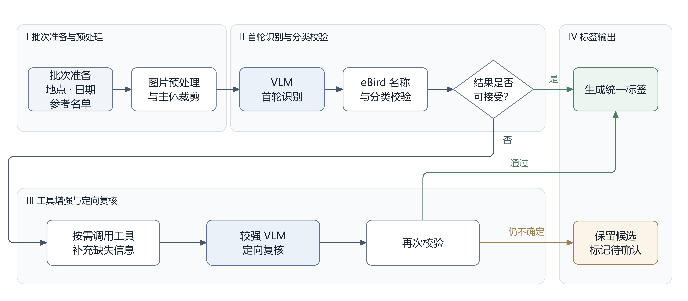
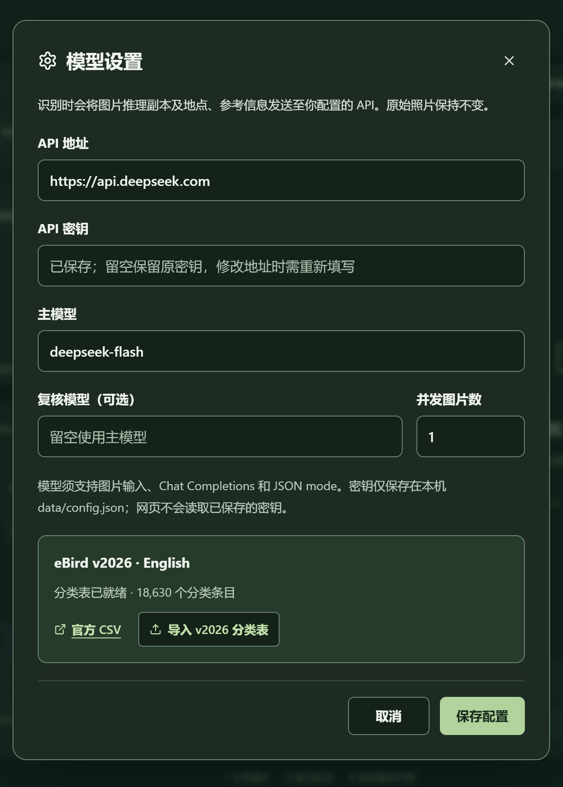
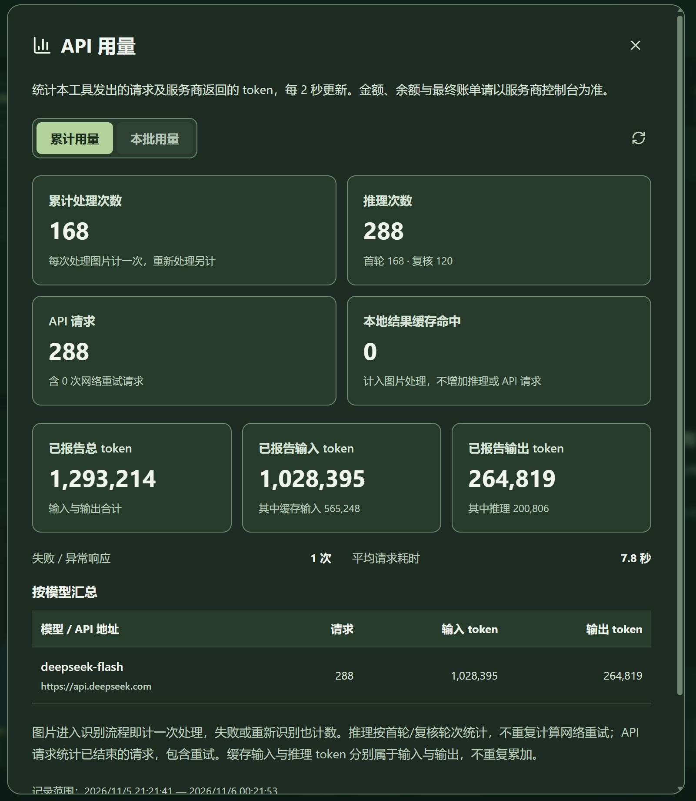

<h1 align="center">WildScene</h1>

<h3 align="center">BirdRecongizer</h3>

<p align="center">
  <a href="https://developer.mozilla.org/docs/Web/JavaScript"></a>
  <a href="https://www.typescriptlang.org/"></a>
  <a href="https://react.dev/"></a>
  <a href="https://vite.dev/"></a>
  <a href="https://nodejs.org/"></a>
</p>

<p align="center">
  <a href="https://github.com/Marconik/BirdRecongizer/releases"></a>
  <a href="LICENSE"></a>
</p>


> 作者: [Marconi](https://marconik.github.io/blogs/2026-11-05.html)
>
> 感谢ChatGPT的帮助

本地运行的批量鸟类图片识别WebUI，其核心是一个VLM的Harness。优势包括

- 支持大批量处理，并且可以存储和复用处理结果
- 支持各种VLM API，可以选择强大的闭源模型，也可以自己本地运行VLM接入，给予了较高的时间花费、成本花费和安全性的可控性
- 加入了多种工具（图片裁切、锐化、曝光调节等）和推理手段，让VLM更准确地识别图片
- 支持展示推理过程和重复识别，同时缓存机制使得准确性可以随着使用次数的增加而上升

目前包含功能：

- 导入单独的照片或者照片文件夹，在WebUI内进行预览
- 调用VLM API进行鸟类识别
- 可以填入拍摄地点、时间、参考列表让识别更加准确
- 如果对识别结果有误，可以勾选重新识别并展示推理过程，重新识别可以选择接入另一个VLM的API
- 标签保存到照片目录，不会因为清理缓存而被删除，同时支持用户自己编辑标签



使用两个地点分别50张图片进行测试，接入`DeepSeek-V4.1-Flash-1017`的官方API，在高峰期运行程序，平均一张照片10s，第一轮正确率70%，对不确定的图片再次进行识别之后第二轮正确率达到95%，100张照片一共160次调用花费2.3元

> 目前仅支持鸟类，首版固定使用 **eBird v2026 官方英文名**，如果识别结果不是鸟类，程序会添加标签`Not Bird`
>
> **目前暂不支持中文名转换**，因为测试数据来自北美，很多鸟类没有准确的中文名
>
> 识别完成的图片支持直接导入项目[Marconik/ImageWall: Provide a network frame for online image viewing](https://github.com/Marconik/ImageWall)进行展示


## 使用方法

> 可直接下载 [GitHub Release](https://github.com/Marconik/BirdRecongizer/releases) 的预构建附件，按 [首次部署指南](QUICKSTART.md) 安装，**Windows 依次运行 `install.cmd` 和 `start.cmd`**
>
> 以下是对源码版本的构建方式。

需要 Node.js **24 LTS**及支持文件夹读写的桌面 Edge / Chrome

```powershell
npm install
npm run taxonomy:install
npm run dev
```

打开 `http://127.0.0.1:5173`。程序会同时启动网页前端（5173）与后端（5174），均只监听本机


1. 点击工具栏齿轮“模型设置”，填写 API 地址、密钥及视觉模型 ID。可选配置复核模型，并发默认 4，可设1~8

   

2. 接入API之后，在暂停键右边的统计按钮可以看到模型的用量信息，其中本批次用量是指按下一次开始键直到自动结束这段时间的用量信息

   

3. 在之前的模型窗口，正确载入鸟类命名规则之后应该显示“eBird v2026 · 分类表已就绪”。安装器下载 [Cornell 官方](https://www.birds.cornell.edu/clementschecklist/download/)固定版本的 eBird Taxonomy CSV，目前只下载2026年版；下载被拦截时，用浏览器下载官方 **eBird Taxonomy v2026 CSV**，在设置窗口导入；或运行 `npm run taxonomy:install -- "C:\path\eBird_Taxonomy_v2026-october-2026.csv"`。本地文件名须包含 `v2026`，校验必需列及至少 10,000 个物种。CSV 没有可靠的内嵌版本声明，须选择正确的官方版本

4. 选择图片所在文件夹并允许读写，在“拍摄时间/地点”设置日期与经纬度。如果没有设置日期或者地点，后端程序会**自动调用照片元数据里的拍摄时间和GPS信息**。为保证安全性，程序没有加入获取用户当前定位的功能

5. 如果在观鸟的同时已经有记录鸟种，可以把记录到的鸟种直接编辑成.txt文件或者.csv表格，导入到参考列表里，供VLM精确锁定候选物种

6. 识别完成的图片会显示标签和推理过程（**推理过程仅保存于浏览器缓存之中**，只能在下一轮推理之前查看），对结果有异议可以勾选重新识别。首个版本下的结果宽松度很低，所以一轮下来会有很大一部分图片被标记为需要重新识别。建议**保留首轮识别勾选的所有需要重新识别的图片，在重新识别之后取消勾选所有仍然标记为需要重新识别的图片**

   

7. 识别完成的标签存储为相同文件夹下的`tags.json`，如果使用我之前构建的[ImageWall](https://github.com/Marconik/ImageWall)相册项目，可以直接把整个照片文件夹链接给相册的后端

## 后续计划

除了优化现有的一些功能的参数以外，还将实现：

1. 照片的导出功能，导出包含时间地点元数据、标签水印的照片
2. 鸟类名字的中文参考
3. 推理过程的质疑功能：用户可以给被勾选重新识别的照片添加质疑或者引导
4. 图片参考功能：添加参考图片库，可能会以网络API的形式实现
5. VLM模型强化：现有的项目同时可以拿来强化训练VLM模型。预计使用小型蒸馏得到的开源VLM进行训练，训练出来的模型可以作为本地部署该Harness的最佳选项


## 详细规则

### 构建要求

模型须支持 Chat Completions、图片和 `response_format: json_object`。通用服务使用 `max_completion_tokens`；官方 DeepSeek 接口单独适配为 `max_tokens`，首轮关闭思考以加快识别，疑难复核使用 low 档思考（分别上限 4,096 / 8,192 输出 token）。不自动猜测模型 ID。远程 API 使用 HTTPS，本机服务可用 HTTP。

配置保存于本机 `data/config.json`；密钥不会返回前端或进入 Git。也可复制 [.env.example](.env.example) 为 `.env` 填写；界面保存的配置优先。只用 `.env` 时，更改后重启后端。

仓库只提供空密钥配置模板。`data/`、`.env`、`artifacts/`、标签文件、运行日志及个人测试脚本均忽略提交；其中可包含本机 API 配置、用量、照片路径与拍摄地点，分享项目时也不要附带这些目录。

```powershell
npm run build    # TypeScript 检查及生产构建
npm start        # 服务 dist 网页与 API，默认 5173
npm test         # 存储、解析、识别、队列及本机 HTTP 集成测试
npm run dev:api  # 已有 Vite 前端时仅启动 5174 后端
```

`npm run preview` 只预览静态页面，完整识别使用 `npm run dev` 或构建后 `npm start`。沙箱若禁止测试连接本机端口，请在允许本机网络的终端运行测试。

### 识别规则

- 开始处理整个文件夹中**未标注或已勾选重识别**的可写、可解码图片，不受搜索筛选影响；其他已有标签保留。每批固定日期、坐标及参考名单快照，更换名单对下一批生效。
- 浏览器按显示方向生成最大长边 4096px JPEG 推理副本；后端移除 EXIF，首轮发送最大长边 1600px 全图。疑难时按 VLM 提供的有效主体框，从 4096px 副本裁剪并复核，原始照片不改写。
- 首轮 VLM 提供最多 3 个候选及可见特征，程序以本地 eBird v2026 校验英文名/学名。明确图片一次调用，疑难图片执行本地分类检索、按需真实裁剪，再复核一次，最多两轮判断。
- VLM 可请求阴影提亮，疑难复核也会对偏暗区域自动生成提亮副本，与原图/裁剪对照查看；不额外调整白平衡或生成细节。最多额外发送一张图片，不增加第三轮判断，但图片输入 token 可能增加。完全黑、过曝或失焦的细节不能通过提亮恢复。
- 仍待确认时保存**最接近的有效官方英文名**，勾选重识别并在预览区显示原因；复核服务失败时也保留首轮候选。非鸟类主体或明确没有动物时保存特殊标签 **`Not Bird`**；证据充分且模型不报告不确定时完成并清除重识别，否则保留待确认及重识别。看不清的主体或没有有效候选时保留旧标签并勾选，不直接归为非鸟。
- 自动接受的初始规则：唯一名称、物种类别、模型不报告不确定、自评至少 0.9、至少两条可见鉴别特征、无关键缺失特征。两轮对应不同分类时仍待确认。自评分数不是经校准的概率，尚未用真实标注集验证准确率。
- 每张完成后立即提交 `tags.json`。提交前保护正在编辑、人工改动、磁盘外部改动及文件夹切换，旧响应不能覆盖新编辑。
- 暂停停止新派发，当前图片完成保存；继续处理剩余队列。暂停且当前图片结束后可修改模型设置。鉴权、配置和兼容参数错误会自动暂停后续派发。
- 刷新或关闭网页停止队列，重开后根据标签及浏览器勾选重新开始；不支持网页关闭后的后台续跑。切换文件夹停止旧任务并忽略其迟到响应。
- 已确认的相同推理副本及上下文可命中本地缓存；日期、坐标、名单、模型和工作流变化会失效，勾选重识别绕过缓存。相似连拍不直接复用，不确定结果不缓存。
- 429/5xx 最多两次传输重试，每次请求限时 90 秒。这些重试不属于新的判断轮次，但可能影响费用。成功缓存记录模型、token 用量与耗时。
- 首版仅识别主体鸟类。区域物种 API、鉴别知识库、授权参考图、自动读取拍摄日期/GPS、印字导出尚未接入；导出保留占位。

仅预览不调用模型；识别时推理副本、日期、经纬度和精简参考信息会发送到你配置的 API。后端不落盘保存图片。配置、分类快照、确认结果缓存在 Git 忽略的 `data/`。

### API 用量统计

- 点击暂停按钮右侧的柱状图图标“API 用量”，可查看累计或当前批次的数据；窗口打开时每 2 秒向本地服务刷新，不额外调用模型。
- 上方四格显示累计处理次数、推理次数、API 请求、本地结果缓存命中。每张图片进入后端识别流程计一次处理，失败、缓存命中、同图重识别分别重新计一次；同一处理中的复核或网络重试不增加图片处理次数。推理按首轮/复核轮次计数，不重复计算网络重试；API 请求包含每次网络重试。例如一张图经首轮和复核、期间重试一次，计为 1 次处理、2 次推理、3 次 API 请求。
- 下方显示输入/输出/总 token、服务商报告的缓存输入和推理 token、异常响应和平均请求耗时，并按模型与服务商汇总。旧版记录未保存图片处理标识，不能准确还原旧处理次数，因此图片处理次数从本次升级起统计并显示说明；旧 API 用量与可还原的推理次数保留。
- 直接依据每次实际请求的返回值记账，包括模型结果截断或 JSON 不合格但已返回 usage 的情况。重试属于请求总数的一部分；缓存输入属于输入，推理属于输出，均不重复累加。本地结果缓存命中记为一次缓存命中、零次新模型调用，不重复计入历史 token。
- 服务商没有完整返回 usage 时显示缺失提示，未知计费不视为零。超时、取消、失败仍可能产生费用，准确金额和账号余额以服务商账单为准；本版不读取组织账单/账号余额，也不套用未经配置的价格估算费用。
- 统计从启用后开始，不追溯旧缓存或其他工具产生的调用。累计记录保存在本机 `data/usage/requests.jsonl`，刷新/重启后保留；本批选择随当前网页任务上下文保留，刷新网页后可继续查看累计。
- 只记录计数、耗时、模型、服务商域名和匿名批次 ID，不保存密钥、照片、文件路径、地点或提示词。日志损坏/保存失败会提示统计不完整，不影响标签保存。

### 标签与浏览器缓存

```json
{
  "DSC02730.JPG": ["Little Egret"],
  "DSC02731.JPG": ["House Sparrow", "sparrow"],
  "DSC02732.JPG": ["Common Kingfisher"]
}
```

- 自动识别写入一个官方英文标签；人工仍可输入多个自定义标签，以英文或中文逗号分隔。清空保存为 `[]`。
- 根目录及每个含图片的子目录各用自己的 `tags.json`，键为原始文件名。原图不改写。
- 人工编辑约 250ms 自动保存，失焦立即提交；识别完成立即保存。前台每秒读取 JSON，回到页面立即检查。浏览器凭目录授权经统一 TagsStore 写回，后端不使用任意本机图片路径。
- 写前读取最新 JSON，仅合并变更文件，冲突有限重试；损坏的 JSON 不覆盖。不能对任意第三方进程提供跨进程事务保证。
- **重识别勾选只写浏览器 localStorage**，不写入 tags.json 或后端缓存。刷新同一文件夹恢复，换文件夹或清缓存清空。识别原因只在当前页面显示；缓存元数据不保存浏览器勾选状态。
- 记住最后打开的文件夹，刷新后有权限则恢复，否则显示“继续打开”。拖入/单选图片只读预览；保存与识别需选择可写文件夹。
- 文件夹和图片选择按钮右侧的“×”可取消当前选择，停止识别、清空列表和预览、释放图片预览资源，并清除浏览器保存的文件夹记录及重识别勾选，刷新后不自动重开。先提交待保存标签；保存失败时保留选择，修复后可重试。此操作不删除原图或 tags.json，不重置模型配置、参考名单或累计 API 用量。

### 地图、参考名单与界面

- “拍摄时间/地点”直接填写经纬度后定位，或点地图、准星选点；支持拖动、按钮缩放及鼠标滚轮缩放，不提供地名输入。
- 日期按本批次设置，可留空表示未知；前后端均检查日期格式、实际月份天数及闰年，并拒绝未来日期。有效日期会传给首轮及复核，不从文件夹名称或 EXIF 自动推断。批次开始后日期与选点锁定。
- 坐标是十进制度数：纬度在前、经度在后，北/东正，南/西负；纬度 ±85.0511、经度 ±180。不解析度分秒或地图链接，不转换坐标系，不读取照片 GPS。底图 OpenStreetMap 需联网。
- TXT 推荐一行一个鸟名；CSV 可用英文名、学名等多列，支持有/无表头、标准引号转义、逗号/分号/制表符及 Excel sep 声明。支持 UTF-8、带 BOM UTF-16、GB18030 回退，最大 10 MB / 100,000 条。
- 前端仅显示名单文件名和记录数。名单每批上传并归一一次，提示包最多 80 个匹配分类及 40 条未映射提示，超出标记截断。首版未实现大名单相关性检索，不保证未发送条目影响识别。
- 名单不是硬性白名单。任意语言的输入作为参考数据，输出只采用官方英文名，不新增中文名称库。日期、坐标与名单保存在当前页面/批次内存，刷新后重新填写。
- Logo 切换日间/夜间模式；支持文件/标签搜索、左右切图、缩放、全屏与标签显示开关，竖图按比例向下延长。


## 文档

- [VLM / eBird 已实现工作流及后续工具](docs/vlm-ebird-workflow.md)
- [验证记录和限制](docs/recognition-verification.md)
- [早期项目规划](docs/project-plan.md)、[识别与成本策略](docs/recognition-strategy.md)

请求字段参考 [OpenAI Docs：Chat Completions](https://developers.openai.com/api/reference/resources/chat/subresources/completions/methods/create)及[图片输入](https://developers.openai.com/api/docs/guides/images-vision)。目录保存参考 [File System Access 官方说明](https://developer.chrome.com/docs/capabilities/web-apis/file-system-access)。MIT licensed.
