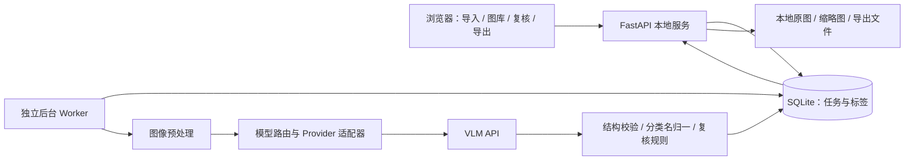

# 本地批量动物识别应用：实施方案

方案日期：2026-11-04（America/New_York）。本文是实施设计，不代表功能已完成。

## 1. 已确认的需求和设计结论

- 本地启动网页应用，批量导入图片，浏览每张图及对应标签。
- 每批提供大致拍摄地点，可选提供参考动物名单；拍摄范围覆盖全球。
- 后端逐图调用可配置的 VLM API，优先识别主体动物到物种级。
- 支持用户修正，导出标签数据，以及把标签印在图片上的新副本。
- 首版使用 API，不依赖本地 GPU 推理；暂不设置用户预算上限，但保留费用统计和可配置的成本控制。
- 数据结构从一开始兼容非鸟类，第一阶段以鸟类识别作为验收重点。

先实现可靠的逐图 API 基线，再通过真实样本比较模型和处理流程。不要在没有评测结果时承诺某个模型“最快、最准、最便宜”，或承诺任意照片都能确定到种。

“本地应用”指界面、任务、图片库、数据库和导出在本机运行。调用云端 API 时，推理用图片及必要上下文仍会发送给所选服务商；这与完全离线运行不同。

## 2. 用户流程

1. 创建批次：填写地点，可补充拍摄日期/日期范围、野外/动物园/饲养环境；允许一个批次中的图片覆盖不同地点。
2. 导入图片或文件夹：第一阶段支持 JPEG、PNG、WebP；读取 EXIF 方向和拍摄日期，生成缩略图。损坏或不支持的文件单独列出。
3. 确认上下文：批次地点是默认值；支持按图片或子批次覆盖。手动值优先于 EXIF；没有拍摄日期就标为未知，不能用导入日期替代。
4. 可选粘贴/上传参考名单：支持中英文名和学名，解析出已匹配、歧义和未匹配项，供用户修正。
5. 选择模型配置和识别模式，显示预计费用区间，启动后台任务。
6. 图片逐张完成、逐张显示；刷新页面或关闭浏览器不会丢失后端任务。
7. 筛选待确认、失败、某物种；放大查看、调整主体框、修改物种、只重跑选中图片。
8. 导出选中图片：选择中文/英文/学名、位置、字体大小、背景样式；预览后生成 ZIP。另可导出 CSV/JSON。

首版不自动把近似连拍归为同一个物种；后续可以加入“建议分组”，仍保留逐图判断和例外处理。

## 3. 技术架构

推荐 React + TypeScript + Vite 前端、Python FastAPI 后端、SQLite 数据库、Pillow 图像处理。理由是浏览大量图片需要成熟的前端交互，而 Python 便于处理 EXIF、裁剪、文字渲染和未来的专用模型。



| 部分 | 首版选择 | 关键要求 |
| --- | --- | --- |
| 前端 | React、TypeScript、Vite | 虚拟化图片网格、分页、键盘复核、缩略图懒加载 |
| API | FastAPI、Pydantic | 输入和模型结果校验，API key 仅在后端使用 |
| 持久化 | SQLite WAL、SQLAlchemy、Alembic | 短事务、版本迁移、识别历史与人工标签分开 |
| 任务执行 | 独立 Python Worker + SQLite 持久化任务表 | 租约、心跳、崩溃恢复、重试、取消 |
| 进度推送 | SSE，断线后补取当前状态 | 事件包含单调递增序号，避免重复刷新 |
| 图像处理 | Pillow + 可用中文字体 | EXIF 方向、sRGB 工作副本、缩略图、带字导出 |
| 模型接入 | OpenAI 适配器 + Gemini 适配器，后续扩展 | 不假设所有“兼容 OpenAI”服务支持同样的图像和结构化输出参数 |
| 配置 | 本地环境变量 / 被忽略的配置文件 | provider、base URL、model、并发、超时、输出上限 |

开发时前后端分开启动，交付时由 FastAPI 托管前端构建产物，提供 PowerShell 启动脚本。默认监听 127.0.0.1。初期无需 Redis、Celery、Docker 或云端数据库。未来多机/多用户需求出现后再升级队列和数据库。

API 请求用异步 I/O 并发；CPU 图像处理使用有界进程池，不能在请求线程里处理整批大图。SQLite 首版使用单 Worker 调度、原子领取任务和有限并发，避免长时间数据库锁。

## 4. 后台任务与可靠性

任务状态：`queued → preprocessing → recognizing → validating → completed / needs_review / failed`；取消进入 `cancelled`。重试按阶段保存，不重新跑已完成图片。

- 每张图独立任务，通过 image_id 和 run_id 关联，不能靠模型返回顺序配对。
- 首次并发 4，允许配置；根据真实 RPM、TPM、延迟和 429 动态调整，不预设所有账户可用相同并发。
- 网络、429、部分 5xx 按 Retry-After / 指数退避与抖动处理，最多有限次数；无效图片、鉴权和余额问题不盲目重试。
- 每次远端调用记入调用记录，包括失败、可能已计费但响应丢失的情况；未知费用与已知费用分开显示。网络超时不代表服务端未处理，不能承诺绝不重复收费。
- Worker 重启后回收过期租约，已提交的服务商 Batch 任务优先恢复查询，避免重复提交。
- 取消停止新任务；已发出的请求不保证能撤销。人工标签不被迟到的模型响应覆盖。
- 模型拒绝、JSON 截断、结构不合法和分类名无法解析分别处理；必要时进行一次受限修复，仍失败进入待确认。

## 5. 核心数据模型

| 表 | 主要字段 / 用途 |
| --- | --- |
| batches | 名称、默认地点/日期、参考名单版本、识别模式、创建时间 |
| images | UUID、原始文件名、管理路径、尺寸、EXIF、缩略图、上下文覆盖、导入状态 |
| contexts | 原始地点文本、用户确认的坐标/区域/半径、日期及来源、环境类型、版本 |
| taxa | 内部 UUID、来源系统、来源 ID、分类版本、学名、rank、上级 ID、名称和别名 |
| reference_lists / entries | 用户原文、解析后的 taxon_id、匹配状态；保留原始输入 |
| recognition_runs | image_id、上下文快照、预处理/提示词版本、provider/model、候选、证据、状态 |
| api_calls | run_id、阶段、请求 ID、尝试次数、耗时、token usage、价格版本、费用、错误 |
| annotations | image_id、当前有效标签、来源（模型/人工）、复核状态、版本 |
| review_events | 修改前后值、操作时间；支持撤销与追踪 |
| jobs / exports | 任务状态、租约、进度、错误、导出参数快照及产物路径 |

物种主键使用“内部 ID + 分类来源 ID + 分类版本”。学名可能因分类修订改变，中文俗名和英文名也不唯一，均不能单独作为永久主键。鸟类优先导入版本化 eBird 分类表，非鸟类使用可替换的分类来源适配器，做跨来源映射时保存来源与版本。

人工标注与模型建议分开保存。重新识别只生成新建议，不覆盖用户已经确认的标签。

## 6. API 草案

| 接口 | 用途 |
| --- | --- |
| `POST /api/batches` | 创建批次及默认上下文 |
| `POST /api/batches/{id}/images` | 有界分批上传，逐文件返回导入结果 |
| `PATCH /api/images/{id}/context` | 覆盖单图地点、日期等 |
| `POST /api/reference-lists/resolve` | 名称解析和歧义检查 |
| `POST /api/batches/{id}/recognitions` | 选择全部/部分图片启动识别 |
| `GET /api/jobs/{id}` | 查询进度、失败详情和用量 |
| `POST /api/jobs/{id}/cancel` | 停止调度未开始任务 |
| `GET /api/batches/{id}/events` | SSE 进度事件 |
| `GET /api/images` | 按批次、物种、状态分页查询 |
| `PATCH /api/images/{id}/annotation` | 修正标签，使用版本号避免写入冲突 |
| `POST /api/exports` | 指定图片和标签版本，启动导出 |
| `GET /api/exports/{id}/download` | 下载 ZIP、CSV 或 JSON |

浏览器普通文件上传不会提供可信的本机绝对路径。首版上传到应用管理目录；后续可另加本地目录导入功能，并对可访问目录进行明确配置。

## 7. 图片、标签和导出

- 原图只读保留；界面标签是覆盖层，识别与修改不重新编码原图。
- 推理图片、缩略图和导出图分开管理。图像方向先按 EXIF 纠正，导出时清理旧方向字段，防止二次旋转。
- 导出默认使用当前有效标签，已确认项优先。未确定项带“待确认”字样，可选择跳过；不得把未确认建议输出成已确认事实。
- 默认左下角半透明底条，按图像尺寸缩放文字，支持换行、中文字体回退、英文名和学名。用户可选其他角落或图外底栏。
- UI 与导出共用标签内容、排版参数和字体；提供后端生成的实际样张预览，避免浏览器字体与 Pillow 字体差异。
- 导出文件使用 image_id 消除重名，附 CSV/JSON 清单记录原名、物种、状态和识别来源；ZIP 分块生成并提供大批次分包。
- 导出默认不携带 GPS 等敏感 EXIF，可提供显式保留选项。首版不改写原图的 EXIF/IPTC/XMP；嵌入元数据作为后续功能。

## 8. 开发顺序与验收

### 阶段 A：样本评测和 API 适配

收集 200–500 张有可靠标注的授权照片，覆盖不同洲、常见种/近似种、幼鸟、雌鸟、小主体、模糊、非鸟、空图和名单外物种；不能把模型自己的输出当标准答案。先验证两家 API、结构化结果、名称解析、用量统计与评测脚本。

产出：按物种/地区切分的准确率、自动接受覆盖率、待确认比例、p50/p95 延迟和每千张实际费用，选出首版默认配置。没有样本和 API key 时，这一阶段的真实结论尚待验证。

### 阶段 B：最小可用闭环

实现导入 → 地点/参考名单 → 后台逐张识别 → 网格和大图标签 → 人工修正 → 带字图片/CSV 导出。先接一家 API，第二家保持同一内部接口。

验收：一批至少 100 张授权样本完整流转；一张失败不影响其他图片；重名、EXIF 旋转、中文长标签均正确；原图未被改写。

### 阶段 C：批量稳定性

加入断点续跑、限流、取消、受限重试、费用统计、虚拟化网格、分包导出。用可控模拟 provider 做 1,000 张任务压力测试；真实 API 在样本规模验证即可，避免用付费大批量测试替代工程测试。

验收：关闭/刷新前端、重启 Worker、429、超时和无效 JSON 都有可恢复状态；人工修改不被覆盖；无图片/结果错配；内存随并发和窗口大小有界。

### 阶段 D：识别优化

在固定测试集上比较裁剪、地点、候选名单、轻量/强模型路由、可选第二服务商复核和异步 Batch。只有收益成立才合入默认路径；本地 BioCLIP 属于后续可选研究，不是首版依赖。

### 暂缓

RAW/HEIC、任意照片中所有动物逐一定位、自动连拍标签传播、训练自有分类器、多用户协作、云端部署。多动物照片首版支持选择主体及标记“主体不明确”，不假装已完成全目标识别。

## 9. 仓库结构建议

```text
frontend/src/          图库、导入、复核、导出、设置
backend/app/api/       HTTP 与 SSE
backend/app/domain/    分类、上下文、标注和任务模型
backend/app/providers/ OpenAI / Gemini / 可配置服务
backend/app/services/  预处理、识别路由、名称归一、导出
backend/app/worker/    调度、限流、租约、重试
backend/migrations/    数据库迁移
backend/tests/         结果配对、任务恢复、解析和导出测试
evals/                 评测代码、分组清单、结果报告
docs/                  设计与模型策略
data/                  本机数据，加入忽略规则
```

实现代码时一并添加忽略规则：API 密钥、`.env`、本机配置、原图、数据库、模型缓存和导出产物不进入 Git。当前规划阶段不安装依赖、不请求付费推理、不上传用户图片。

## 10. 资料依据

识别路线、官方 API 文档、模型价格与评测口径见 [识别与成本策略](recognition-strategy.md)。本文中的技术栈、并发初值、阶段规模和架构均为本项目建议，并非模型厂商对性能的保证。
