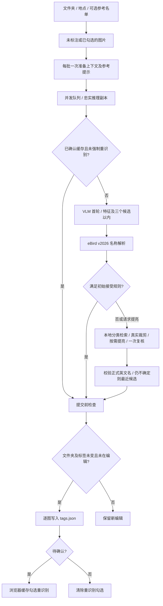

# VLM / eBird 工作流

2026-11-05 首版已实施。固定 **eBird v2026 / English**，待确认时按用户规则保存最接近候选并自动勾选重识别。

## 分类与参考

使用 [Cornell 官方 v2026 eBird Taxonomy CSV](https://www.birds.cornell.edu/clementschecklist/download/)，本地按英文名、学名、分类代码索引，版本不自动升级。分类表未就绪时不调用模型。本次下载快照有 18,630 个分类条目；条目数包含物种外类别，不能当成物种数。CSV 无内嵌可靠版本声明，本地导入需由用户选择名称包含 v2026 的正确官方文件，程序检查表头及全球物种数量。

模型代码单独不能作为身份依据，需要名称匹配。英文名与学名指向不同分类时复核。模糊检索仅找候选，不能直接确认为物种。物种对、属级未定、杂交和家养类型按不确定结果处理，不强制转成物种。[eBird 分类类别](https://support.ebird.org/en/support/solutions/articles/48000837816-the-ebird-taxonomy)。

eBird 代码跨年度不一定代表相同分类概念，未来升级需显式迁移，不把旧码直接解释成新概念。[官方版本说明](https://www.birds.cornell.edu/clementschecklist/introduction/updateindex/october-2026/)。

网页的“拍摄时间/地点”按批次设置日期及经纬度，不再提供地名输入或坐标展开按钮。经纬度可直接填写后点击“定位”，也可地图点选；地图选点、中心选点与清除会同步输入框。日期使用本机当地日历日期，允许留空表示未知；浏览器与后端共用校验，拒绝非 YYYY-MM-DD、无效月份/天数/闰日、0000 年及未来日期。当前为用户填写的批次日期，尚不自动读取照片 EXIF。识别准备、进行及暂停期间锁定日期和选点，避免批次上下文与界面混淆；新批次会将日期作为 `captured_at` 连同 `coordinates` 提供给首轮与复核，并参与缓存键。

每批固定坐标、日期和名单。名单上传和归一一次，短提示最多 80 个匹配分类和 40 条未映射数据，超出标记截断；尚未实现大名单相关性检索。英文名/学名用于正式解析，其他语言保持不可信参考，不自动翻译官方名字。地点、日期和名单都是软提示，允许名单外、迷鸟、迁徙、饲养与上下文错误。

## 图片与模型

浏览器按显示方向生成最大长边 4096px JPEG，后端移除 EXIF并生成 1600px 首轮全图。VLM 可以返回主体框，程序验证归一化坐标并加 12% 边界，从 4096px 副本提取真实裁剪，再缩至 1600px 送复核。没有检测器，也不生成或补画细节。

`english-v2026-3` 增加本地 `image.exposure` 工具：首轮可返回 `image_adjustment: "brighten"` 请求提亮并触发一次复核。进入疑难复核时，程序还会优先检查主体裁剪（没有有效框则检查全图）：128px 缩略图亮度中位数低于 75/255 或至少 20% 像素亮度低于 48/255 时自动提亮。这些阈值是尚未在标注集校准的初始启发式，属于偏暗路由提示，不是对真实羽色或欠曝的确定判断；清楚且未请求提亮的首轮仍可直接接受。

增强采用有界阴影曲线，暗部 sRGB 通道值最多约 2.5 倍（不等同于 RAW 曝光补偿），亮部提升较少，每个像素 RGB 同比缩放并限制峰值，避免单通道溢出；不额外调整白平衡、饱和度、锐度或生成细节。原图/未调色裁剪与提亮副本一起标明来源后送入同一次复核，最多额外增加一张图片输入，不增加第三轮请求。完全黑、过曝及失焦处无法由提亮恢复证据。增强失败回退未调色图片，取消请求仍会停止后续 API 调用。

识别响应的 `tools` 在成功生成提亮图时含 `image.exposure`；`image_adjustment` 保存是否应用、模型请求/自动触发、裁剪/全图来源及亮度诊断和曲线参数，不保存图片字节。复核提示要求区分阴影与羽毛颜色，不能把提亮后的亮度当作真实羽色。原照片、预览和 tags.json 格式不变。缓存版本已提升，旧版已确认缓存不会被新流程复用。

固定 JSON 返回主体状态、最多三个候选、英文名/学名、短可见特征、关键缺失、自评分数、是否待确认及可选框/检索词。受限字段由程序解释并调度工具，不开放任意文件、URL、shell 或无限循环 Agent。

自动接受须同时满足：鸟类主体、首选名称唯一、species 类别、未报告待确认、自评至少 0.9、两条可见证据以上、没有关键缺失特征。两轮不同有效分类仍待确认。这是未校准的初始规则；名称存在不证明图片判断正确，自评分数不是实测概率。

疑难图追加一次复核，可配置较强模型，未配置则复用主模型；提供本地分类搜索结果和可用裁剪，允许名单外候选，再次校验。最多两轮判断，429/5xx 每轮另有两次以内传输重试，单次请求限时 90 秒。

仍待确认或复核失败，保留最接近的有效英文候选并勾选重识别；若复核未给出新有效候选，保留首轮有效候选。非鸟、无鸟或完全无候选时不虚构名字，保留旧标签并勾选。此类结果不计种级成功。

## 提交、暂停与缓存

`tags.json` 仅存文件名到标签数组，例如 `{"DSC02730.JPG":["Bald Eagle"]}`，不加待确认后缀或勾选布尔值。每张完成后经浏览器目录授权，由已有 TagsStore 统一立即写回。前端仍每秒读取 JSON；后端不获取任意图片绝对路径，不另起标签写入者。

提交前检查工作空间、图片 ID、初始标签、人工编辑修订号、正在编辑的输入框，并刷新磁盘标签。运行期间人工改过又改回相同文字也受修订号保护。不能向任意第三方进程提供跨进程事务。

待确认勾选只写 localStorage，换文件夹或清缓存清空。暂停停止新派发、等待当前图片完成保存；刷新/关闭网页结束队列，重开后根据标签和浏览器勾选重新开始，不后台续跑。换文件夹取消旧队列和请求并忽略迟到响应。

默认并发 4、可调 1–8。仅缓存相同推理图片与上下文的已确认结果；地点、名单、模型、提示版本变化失效；勾选重识别绕过。相似连拍不直接复用。缓存包含分类、版本、证据、模型、token 用量及耗时，不含图片、密钥或浏览器勾选。模型配置和缓存都被 Git 忽略，服务仅监听本机。

## 后续扩展

| 工具 | 首版状态 | 后续用途 |
| --- | --- | --- |
| taxonomy.search / resolve | 已有本地索引 | 带来源别名、跨版本映射 |
| image.crop | 已有受限框裁剪 | 检测器及裁剪质量评测 |
| image.exposure | 已有模型请求 / 疑难偏暗自动触发的阴影提亮，对照原图复核 | 对逆光图评估效果、误触发率与额外图片 token |
| review.identify | 已有一次复核路由 | 标注集校准模型与阈值 |
| ebird.region_context | 未接入 | 历史地区线索，需个人 API key 及合适数据 |
| bird_traits.compare | 未接入 | 有来源的近似种、幼鸟和季节鉴别知识库 |
| reference_images.get | 未接入 | 明确授权、符合年龄/姿态的少量参考照片 |

eBird 近期观测缺失不能作为物种不可能出现的证据，历史照片不能直接套用今日记录。[数据接口说明](https://support.ebird.org/en/support/solutions/articles/48000838205-download-ebird-data)。公开浏览媒体不代表可随意下载后转发模型，参考图需授权，不依赖 Merlin 私有接口。[媒体使用说明](https://support.ebird.org/en/support/solutions/articles/48001064551-using-and-requesting-media)。

下一步准备 200–500 张可靠人工标注图片，按连拍/个体分组隔离调参与测试，覆盖全球地区、近似种、幼鸟/雌鸟、小主体、无鸟、错误地点。记录准确率、自动接受精确率与覆盖率、待确认率、映射失败率、p50/p95 延迟及每千张费用，再确定模型与门槛。逻辑判断平均轮次可按 1+r 统计（r 为复核比例），不能当作实测费用或速度保证。
